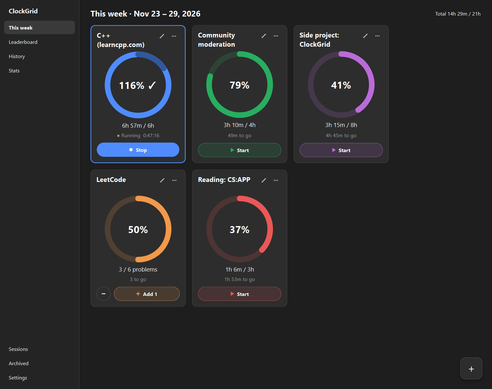
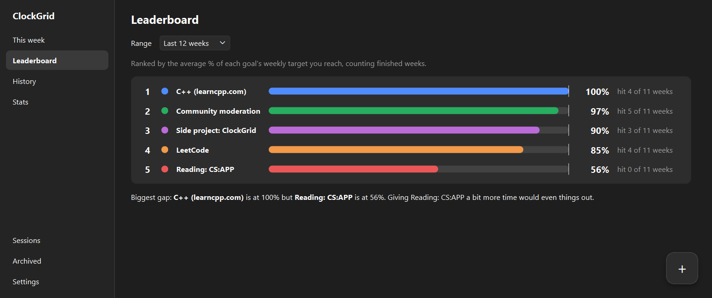
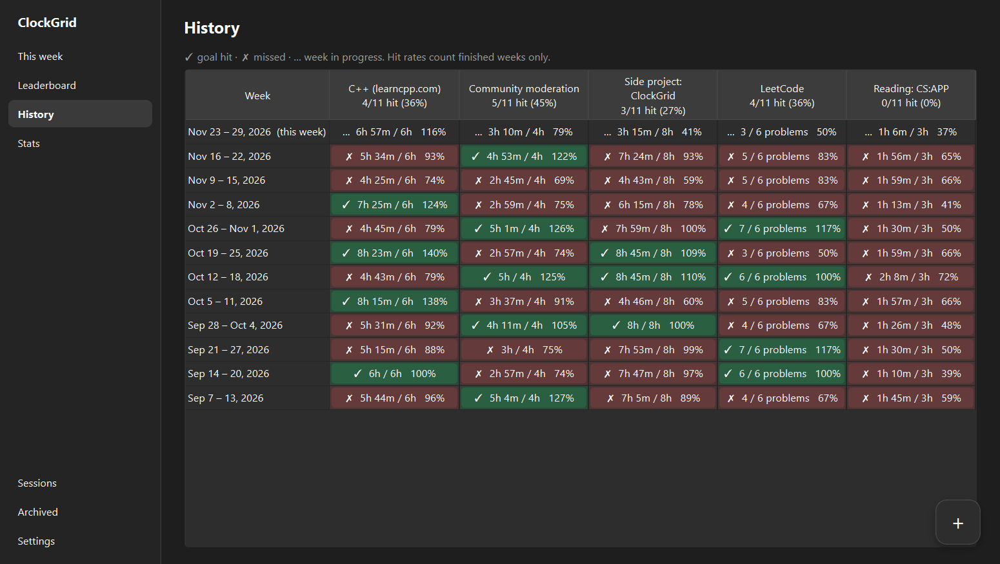
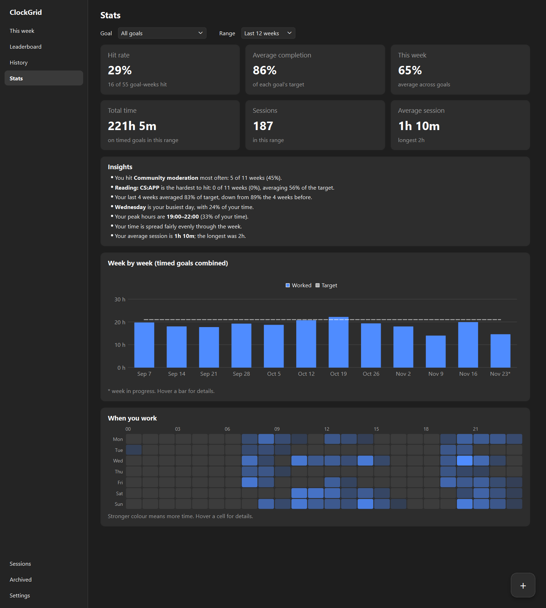

<p align="center">
  
</p>

<h1 align="center">ClockGrid</h1>

<p align="center">
  A desktop time tracker for weekly goals. One clock per goal, a timer for whatever you're working on,
  and stats that show which goals you keep and which ones quietly slip.
</p>

<p align="center">
  
</p>

## Why

"I'll do 6 hours of C++ this week" is easy to say and hard to check. ClockGrid turns each weekly
goal into a ring that fills as you work, then keeps the score: hit rates, streaks, trends, and a
leaderboard that shows when one goal is eating the time meant for another.

## Features

### This week
- **A clock per goal**, filling towards its weekly target. Go past 100% and a second, darker lap shows the overshoot.
- **Time or count goals**: track hours ("6 hours of C++") or a number of things ("6 LeetCode problems").
  Count goals get a **+1** button (and a − to undo) instead of a timer.
- **One timer at a time**: starting a goal stops whichever one was running. Timers keep running while the app is closed, since only the start time is stored.
- **Drag to reorder**: grab a card and drop it where you want it; the order is saved.
- **Fix-ups**: add, edit or delete sessions by hand for when you forget to press Start. Accidental clicks under a minute are discarded.

### Leaderboard
Goals ranked by the average share of their weekly target you actually reach, with a nudge towards
whichever one is falling behind.

<p align="center">
  
</p>

### History
Every week since you started: each goal marked hit (✓), missed (✗) or in progress, with a hit rate per goal.

<p align="center">
  
</p>

### Stats
Filter by goal and by range (last 4, 12 or 26 weeks, or all time):

- Hit rate, average completion, streaks, total time and session lengths
- A week-by-week chart of time worked against the target
- A weekday × hour heatmap of when you actually work
- Written insights: your most and least reliable goals, whether you're trending up or down,
  your busiest day, your peak hours, and whether you leave everything to the weekend

<p align="center">
  
</p>

## Getting started

Requires Python 3.11+ on Windows.

```powershell
python -m venv .venv
.venv\Scripts\python -m pip install -e .[dev]
.venv\Scripts\python -m clockgrid
```

Or press **F5** in VS Code.

### Install as a Windows app

```powershell
.venv\Scripts\python -m pip install -e .[build]
.\build.ps1
```

This builds `ClockGrid.exe` with PyInstaller, installs it to `%LOCALAPPDATA%\Programs\ClockGrid` (no
admin rights needed) and adds it to the Start menu. To update the installed app after changing the
code, close ClockGrid and run the script again. `.\build.ps1 -NoInstall` only builds. To uninstall,
delete that folder and the Start menu shortcut.

## How the numbers work

- **Sessions are the source of truth.** Every number is derived from start and end timestamps, so
  editing a session updates the history, leaderboard and stats.
- **Targets are versioned per week.** Raising a target from 5h to 8h applies from this week on;
  past weeks are still judged against what you were aiming for at the time.
- **Only finished weeks count** towards hit rates, averages and the leaderboard, so a half-done week
  never shows as a miss. A week with nothing logged does count as a miss.
- **Sessions are split at week boundaries**, so a session running past midnight on the last day of the
  week counts towards each week correctly. Weeks follow local time, including daylight-saving changes.

## Your data

Everything stays on your machine in a single SQLite file at `%APPDATA%\ClockGrid\clockgrid.db`.
Set the `CLOCKGRID_DB` environment variable to use a different file.

## Development

```powershell
.venv\Scripts\python -m pytest                   # run the tests
.venv\Scripts\python tools\make_screenshots.py   # regenerate the README screenshots from demo data
.venv\Scripts\python tools\make_icon.py          # regenerate the app icon
```

| Path | What's there |
|---|---|
| `clockgrid/db.py` | SQLite storage: goals, sessions, weekly target snapshots, settings |
| `clockgrid/weeks.py` | Week boundaries and duration formatting |
| `clockgrid/stats.py` | Weekly results, streaks, leaderboard, heatmap and insights |
| `clockgrid/ui/` | The PySide6 interface: main window, pages, clock cards, charts and dialogs |
| `tests/` | pytest suite for the data and stats layers |
| `tools/` | Icon and screenshot generators |
| `build.ps1` | Builds and installs the Windows app |

The screenshots are rendered from a made-up demo database, never from your own data.
